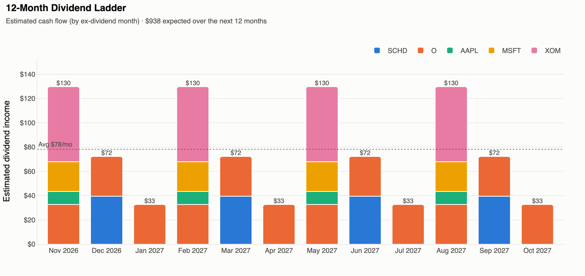
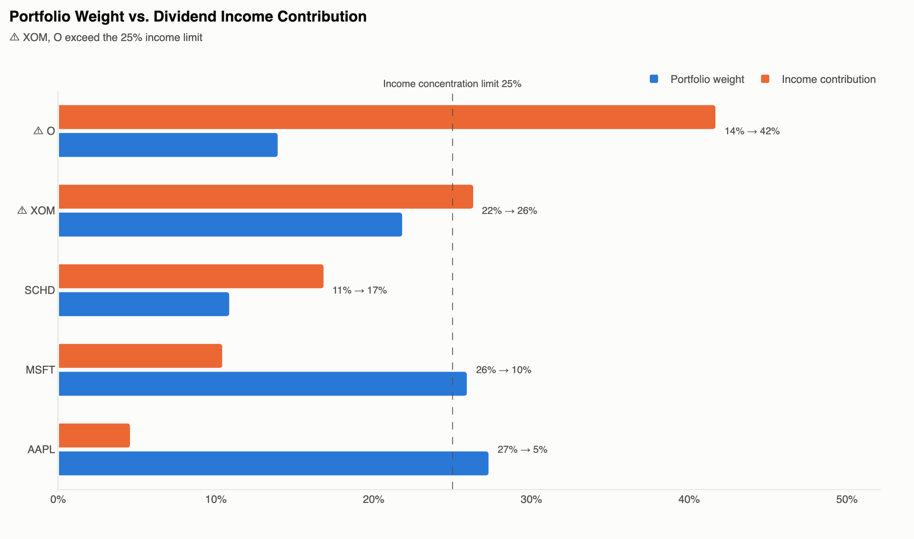
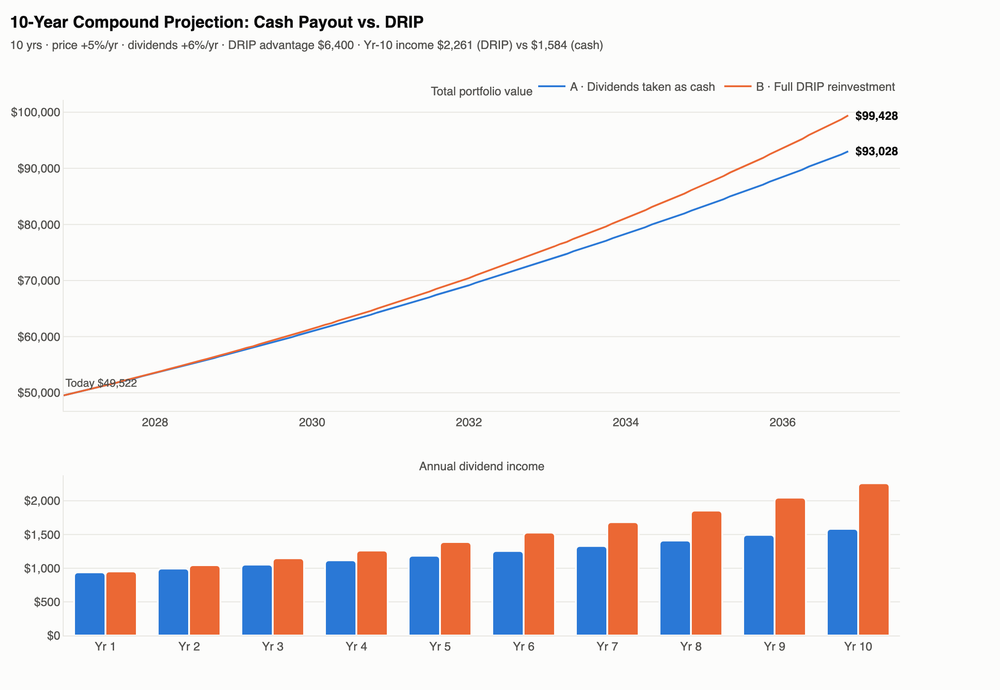

# Dividend Growth Tracker & Visualizer

Tracks a dividend portfolio with live Yahoo Finance data. It works out yield, yield on cost, and payout-ratio safety for each holding, and builds three interactive charts plus one HTML dashboard.



| Weight vs. income contribution | 10-year projection: cash vs. DRIP |
|---|---|
|  |  |

*The charts above come from the sample portfolio in `portfolio.csv`, using live data on 2 Nov 2026.*

## How it works

1. **Input:** the portfolio comes from `portfolio.csv` (`Ticker,Shares,AvgCost`) or from the `SAMPLE_PORTFOLIO` built into the script. Duplicate lots are merged into one position, using a share-weighted average cost.
2. **Fetch:** for each ticker, yfinance supplies the price, dividend history, forward dividend rate, payout ratio, EPS, and sector/industry. If a field is missing, the script falls back to another source (listed under Edge cases).
3. **Metrics:** market value, cost basis, G/L, forward income, current yield, yield on cost, payout ratio with a safety flag, 5-year dividend CAGR, portfolio weight, and income share. A TOTAL row is added at the bottom.
4. **Schedule:** the script works out how often each ticker pays (monthly, quarterly, and so on) from the gaps between past ex-dates. It then spreads the forward dividend across the next 12 months.
5. **Projection:** a month-by-month simulation for each position. In Series A the dividends are kept as cash. In Series B (DRIP) each payment buys fractional shares at that month's price.
6. **Output:** the summary prints to the console. CSV files and the HTML charts and dashboard are written to `output/`.

## Setup

```bash
git clone https://github.com/harshon17fps/dividend-growth-tracker.git
cd dividend-growth-tracker
python3 -m venv .venv
source .venv/bin/activate
pip install -r requirements.txt
```

## Run

```bash
python dividend_tracker.py                                  # sample portfolio
python dividend_tracker.py --portfolio portfolio.csv --show # your CSV, opens dashboard
python dividend_tracker.py --years 15 --price-growth 0.04 --div-growth 0.07
python dividend_tracker.py --pay-lag-days 14                # shift ex-dates toward pay dates
```

| Option | Default | Meaning |
|---|---|---|
| `--portfolio` | built-in sample | CSV file with `Ticker,Shares,AvgCost` |
| `--output-dir` | `output` | Folder where charts and CSV files are written |
| `--years` | 10 | Projection length in years |
| `--price-growth` | 0.05 | Yearly price growth |
| `--div-growth` | 0.06 | Yearly dividend growth |
| `--pay-lag-days` | 0 | Days added to each ex-dividend date to estimate the pay date |
| `--concentration-limit` | 0.25 | Flags any position that produces more than this share of total income |
| `--show` | off | Opens the dashboard in your browser |

## Outputs (`output/`)

- `dashboard.html`: KPI tiles, the metrics table, and all three charts on one page
- `chart1_dividend_ladder.html`: estimated income for each of the next 12 months, stacked by ticker
- `chart2_weight_vs_income.html`: each position's share of portfolio value next to its share of income
- `chart3_projection.html`: 10-year value curves for cash vs. DRIP, plus income per year
- `portfolio_summary.csv`, `dividend_schedule_12m.csv`, `projection_monthly.csv`

## Using it from Python

```python
from dividend_tracker import PortfolioTracker
import pandas as pd

t = PortfolioTracker(pd.DataFrame({"Ticker": ["SCHD", "O"], "Shares": [100, 50], "AvgCost": [26, 55]}))
t.fetch_data()
summary = t.compute_metrics()        # DataFrame
projection = t.project()             # monthly DataFrame
t.chart_dividend_ladder().show()
```

## Methodology notes and limitations

- **Forward dividend:** uses Yahoo's `dividendRate` first. If that's missing, it uses the sum of the last 12 months of dividend history, then Yahoo's trailing rate. This is why ETFs such as SCHD use trailing-12-month (TTM) payouts.
- **Payout ratio:** Yahoo's figure is used when available. Otherwise the script computes TTM dividends ÷ trailing EPS. The safety limit is 75% for corporations and 90% for REITs. Funds are shown as N/A.
- **REIT caveat:** payout ratios based on GAAP EPS overstate REIT risk, because depreciation pushes EPS down. Realty Income (O) shows up at around 230%. It is flagged because that's the rule you asked for, but REITs are better judged on AFFO payout, which Yahoo doesn't provide.
- **Pay dates:** yfinance only exposes ex-dividend dates, so the ladder groups payments by ex-date month by default. Use `--pay-lag-days` to shift them (MSFT and XOM pay roughly 3–4 weeks after the ex-date).
- **Projection:** prices compound monthly. Dividend per share rises once every 12 months. There are no taxes, fees, or new contributions. In Series A, cash is held without earning interest.
- Yahoo data can be delayed or revised. This is an analytical tool, not investment advice.

## Edge cases handled

- If a ticker has no usable price, it is skipped with a warning.
- A stock that doesn't pay a dividend is flagged `NO DIVIDEND` and still counts toward portfolio value.
- If the last payment was more than 400 days ago and there's no forward rate, the dividend is treated as suspended.
- If a ticker pays a dividend but has no history, the script assumes a quarterly schedule (Mar/Jun/Sep/Dec).
- If EPS is zero or negative and there's no payout ratio, the position is flagged `RISKY (EPS ≤ 0)`.
- Failed network calls are retried with increasing waits between attempts.
- Rows with invalid share counts or costs are dropped, and duplicate lots are merged.

## License

Released under the [MIT License](LICENSE). This is an analytical tool, not investment advice.
